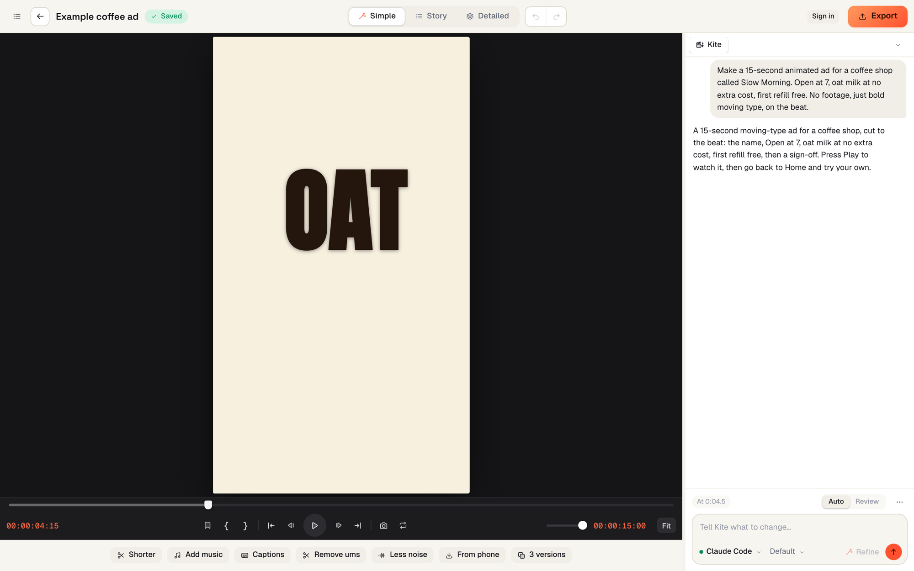
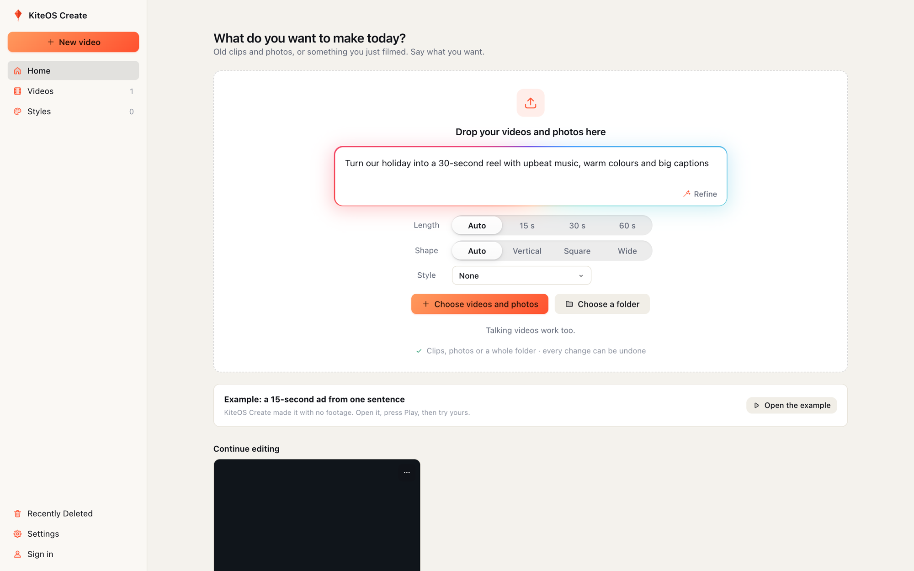
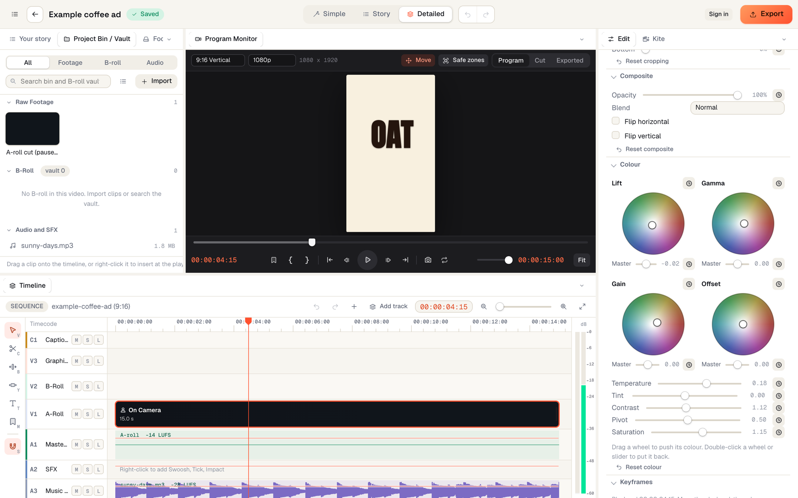
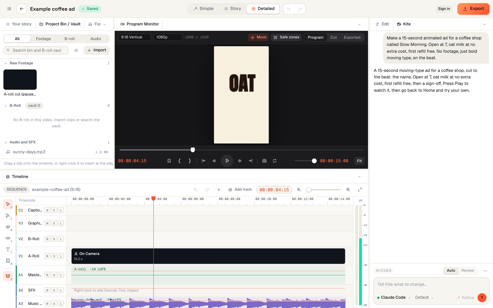
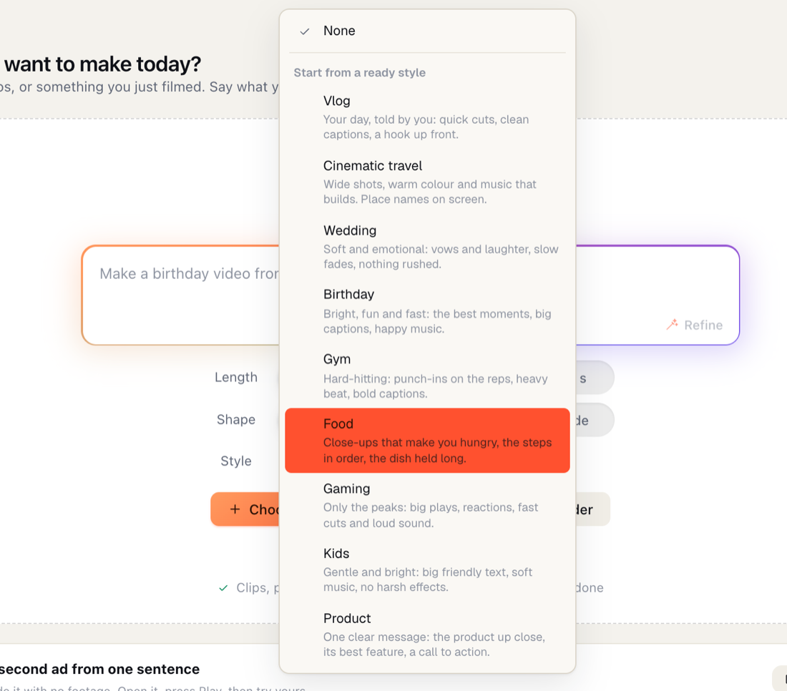
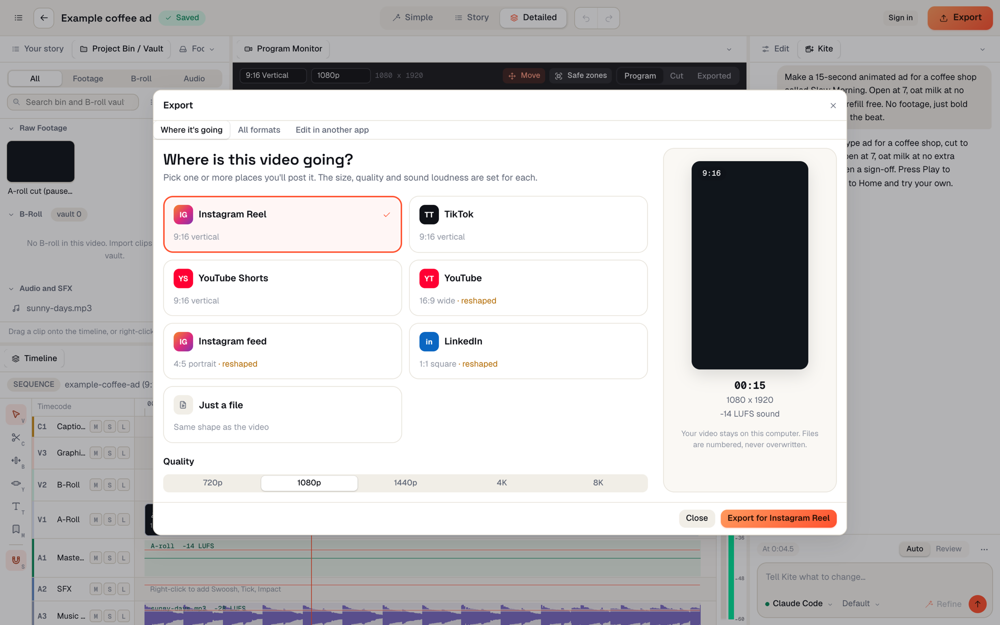

<div align="center">

# KiteOS Create

### Tell it the video you want. It edits it on a real timeline, and you can change every cut.

A free video editor for Mac and Windows. You bring the AI you already use.

<a href="https://github.com/AmiGlitched/kiteos-create-app/releases/latest"></a>
<a href="https://github.com/AmiGlitched/kiteos-create-app/releases/latest"></a>

<a href="https://github.com/AmiGlitched/kiteos-create-app/releases/latest"></a>

<a href="https://creativedesk.online/create"></a>

<br><br>



<sub>This 15-second ad came from one sentence and no footage. It ships with the app, so you can open it and press Play.</sub>

</div>

---

## Your clips and one sentence

Drop in phone clips, old photos or a whole folder, then write what you want: *"Turn our holiday into a 30-second reel with upbeat music, warm colours and big captions."* KiteOS Create picks the best moments, cuts what drags, and adds captions, music, sound effects and colour.

Talking videos work too. It removes the ums and long pauses and turns down hiss and hum in the voice, with no AI needed for either.



## Every AI edit is a setting you can move

Nothing the AI does is baked into the picture. It lands on the timeline as an ordinary setting, the way DaVinci Resolve or Final Cut Pro stores an edit. That includes the crop, the opacity and blend mode, a keyframed push-in, and the Lift, Gamma, Gain and Offset colour wheels. Change any of them by hand, or ask for something different, and undo either way.



## Three views: Simple, Story and Detailed

Three views of the same video. **Simple** is the preview, a row of one-tap changes (Shorter, Add music, Captions, Remove ums, Less noise, 3 versions) and the Kite chat. **Story** lays the video out scene by scene. **Detailed** is a multi-track timeline with captions, graphics, B-roll, footage, dialogue, sound effects and music.



When a big edit runs, several AIs work at once: one sets the pacing, then captions, colour and sound are done side by side. In Detailed view, the part of the timeline being worked on lights up as it happens.

## Styles that learn how you edit



Start from a ready style (Vlog, Cinematic travel, Wedding, Birthday, Gym, Food, Gaming, Kids, Product) or make your own for a person, a brand or a kind of video. Tag it in a request with @, like a mention in WhatsApp, and the video follows it.

A style learns from what you change after the AI's edit: how long you keep videos, how fast the cuts are, where the captions sit, the colour, how loud the music is. The next video starts closer to how you would have cut it.

<br clear="right">

## Export for every platform

Pick Instagram Reel, TikTok, YouTube Shorts, YouTube, Instagram feed, LinkedIn or just a file. Each one gets its own shape, quality and loudness, from 720p up to 8K. Files are numbered and never overwritten. You can also send the edit to another app as a Final Cut, Premiere, DaVinci or After Effects timeline.



## Free, with the AI you already use

KiteOS Create has no AI of its own and charges nothing for one. Connect any of these:

| Connect | What it costs you |
|---|---|
| **Claude Code**, **OpenAI Codex** or **Google Antigravity** | Nothing extra: the edits come out of the plan you're signed in to |
| **An API key** from Anthropic, OpenAI or Google | What the provider charges for the requests |
| **A local model** in Ollama or LM Studio | Nothing, and nothing leaves your computer |

You don't need an AI at all for the timeline, removing pauses, transcription and captions, quick reels made by simple rules, or exporting. **Kite AI**, one paid subscription covering editing, video generation and voice-overs, is coming later for people who'd rather not connect their own.

## Download

**[Get the latest version](https://github.com/AmiGlitched/kiteos-create-app/releases/latest)**

| Computer | What it needs |
|---|---|
| **Mac** | Apple Silicon (M1 or newer). macOS 15 or newer recommended |
| **Windows** | Windows 10 or 11, 64-bit |
| **Not yet** | Intel Macs, Linux |

You sign in with a free KiteOS account.

### Opening it the first time

The app isn't signed with an Apple or Microsoft certificate yet, so your computer warns you once.

- **Mac:** open the `.dmg` and drag KiteOS Create into Applications. If macOS won't open it, go to **System Settings > Privacy & Security** and click **Open Anyway**. Or run this once in Terminal:
  ```
  xattr -dr com.apple.quarantine "/Applications/KiteOS Create.app"
  ```
- **Windows:** if SmartScreen says "Windows protected your PC", click **More info**, then **Run anyway**.

Each release lists the SHA-256 of its files, so you can check that a download matches.

## Privacy

Your videos stay on your computer. When you ask for an AI edit, your words, the transcript and frames from the video go to the AI you connected, under that provider's terms. With a local model they go nowhere.

## Bugs and ideas

Open an [issue](https://github.com/AmiGlitched/kiteos-create-app/issues) with what you did, what you expected, and your Mac or Windows version. A screenshot helps. This is an early build, so expect rough edges.

<sub>KiteOS Create is made by Almure Pressery Private Limited. This repository holds the installers and release notes; the source code is private.</sub>
